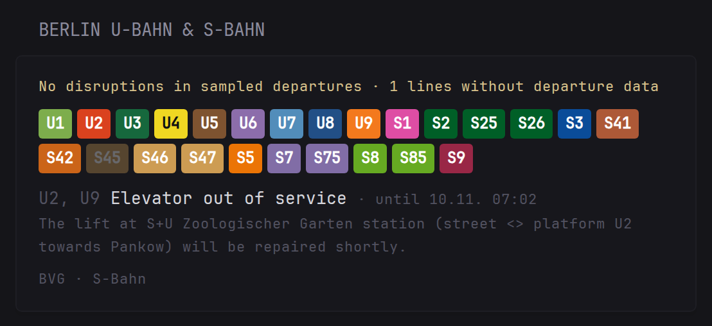
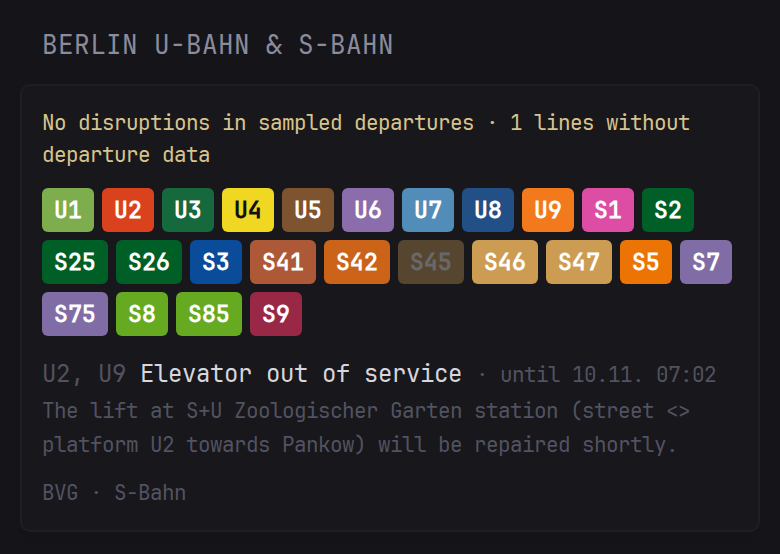
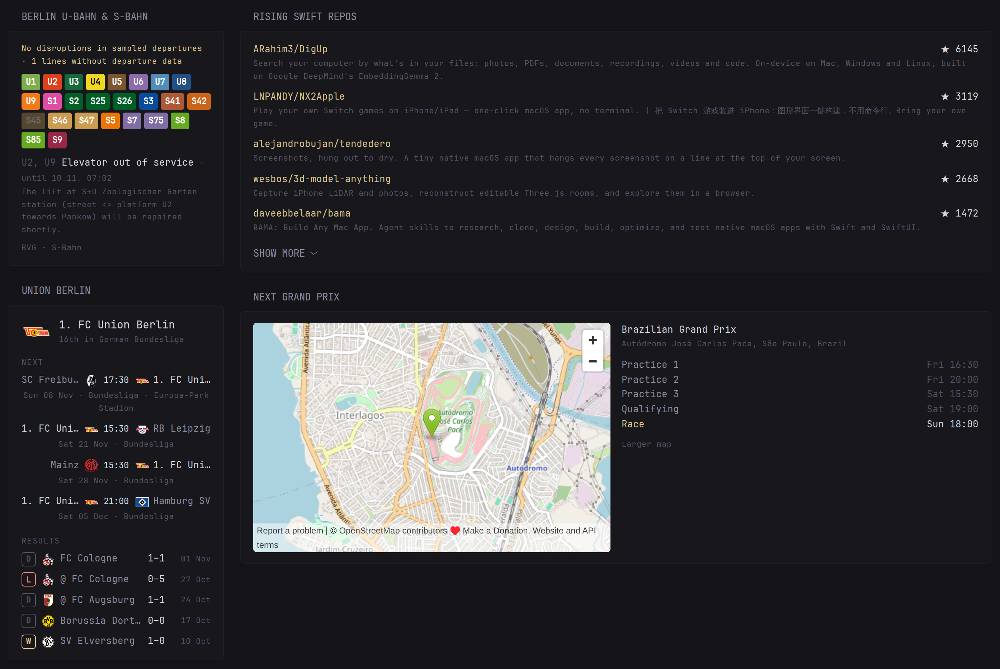
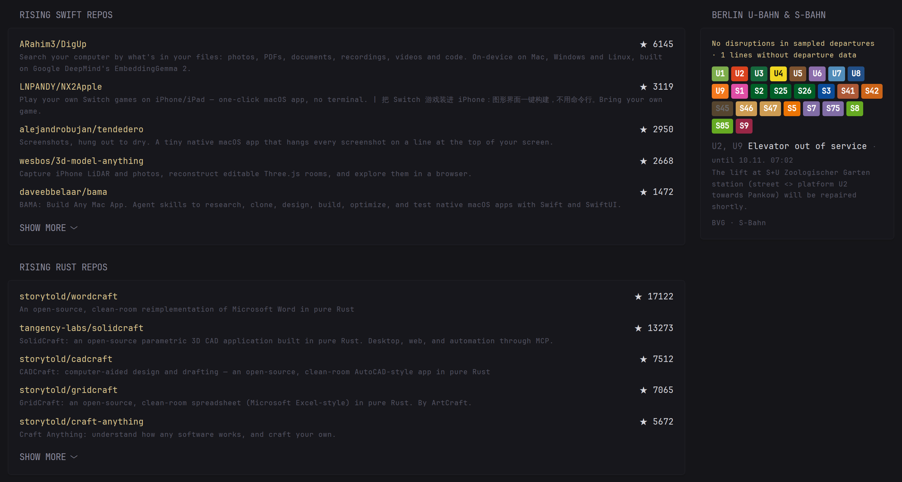

# Glance Berlin Transit

A [Glance](https://github.com/glanceapp/glance) extension widget that shows sampled departure status for Berlin U-Bahn and S-Bahn lines, plus current disruption notices.



It reads departures and their remarks from the public [BVG REST API](https://v6.bvg.transport.rest) at nine hubs that together cover all lines. No API key. Data is cached for 5 minutes, and the last good copy is shown if the API is down. Python standard library only.

Coverage is U-Bahn and S-Bahn. Line state comes from departures seen in the next 30 minutes at those hubs, so a dimmed line means no departures were seen, not that it is out of service. Disruption texts come from BVG in German.

## Install

```sh
docker compose up -d --build
```

Without Docker: `python3 app.py` (Python 3.9+ with system timezone data, `PORT` sets the port).

## Glance config

```yaml
- type: extension
  url: http://berlin-transit:8080/
  cache: 5m
  allow-potentially-dangerous-html: true
  parameters:
    lang: en
    # lines: U1,U7,S7
```

Use a URL your Glance server can reach. `allow-potentially-dangerous-html` is required because the widget returns HTML.

| Parameter | Default | Meaning |
|---|---|---|
| `lang` | `en` | Interface language: `en`, `de` or `tr` |
| `lines` | all | Comma-separated lines to show |

## Environment

| Variable | Default | Meaning |
|---|---|---|
| `PORT` | `8080` | Listen port |
| `CACHE_SECONDS` | `300` | How long results stay fresh |
| `RETRY_SECONDS` | `120` | Wait after a failed refresh |
| `BVG_API` | `https://v6.bvg.transport.rest` | API base URL |
| `BVG_HUBS` | 9 central stations | Comma-separated stop IDs |

## How it works

When Glance asks and the cache is older than 5 minutes, the service fetches the next 30 minutes of U-Bahn and S-Bahn departures, with remarks, at nine hubs: Alexanderplatz, Friedrichstraße, Zoologischer Garten, Nollendorfplatz, Hermannplatz, Hermannstraße, Ostkreuz, Südkreuz and Gesundbrunnen. Together they cover every line. Each line then gets one state:

- disrupted (red): 2 or more cancelled departures, or an active BVG warning whose text says Störung, Ausfall, unterbrochen, Sperrung and similar
- delayed (yellow): median delay of 3 minutes or more, or a warning about construction, replacement buses or diversions
- dimmed: no departure of that line seen in the window (night, or not passing a sampled hub)
- normal: everything else

Active warnings are listed below the line grid with their end time.

If the API fails, the last good result is shown with its time; if some hubs fail, the widget says how many were reached. Field-level details are in [DATA.md](DATA.md).

## Screenshots

On a phone:



Next to the [glance-widgets](https://github.com/darkbringer1/glance-widgets) football and GitHub widgets:




The preview uses data from the moment it was taken, not current service information.

## Maintenance and testing

```sh
python3 -m unittest -v          # parser, caching, partial failure, HTML escaping
docker compose up -d --build
curl -s 'http://127.0.0.1:8080/?lang=en' | head   # the HTML Glance receives
docker compose logs -f
```

- Widget says "No BVG data right now": open `https://v6.bvg.transport.rest/stops/900100003/departures?duration=30&remarks=true` in a browser. If that fails too, the public API is down; the widget recovers by itself.
- A line is always dimmed: a hub may have changed its id. Find stops with `https://v6.bvg.transport.rest/locations?query=<name>` and set `BVG_HUBS`.
- New lines or colours: edit `LINES` at the top of `app.py`.
- New language: add an entry to `TEXT` in `app.py` and a test.

The API is run by [derhuerst](https://github.com/derhuerst) for the community; be gentle and keep the cache at 5 minutes or more. It allows 100 requests per minute; one refresh uses 9.

## Limits

Coverage is a sample of departures at the configured hubs, not a complete network incident feed. Missing lines and partially unreachable hubs are reported explicitly. Disruption texts come from BVG in German. Not affiliated with BVG or VBB.

## License

MIT, see [LICENSE](LICENSE).
